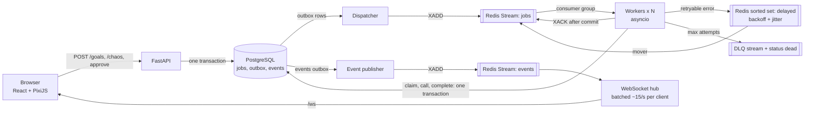

# Agent Town

A live city map of a real distributed job engine. Type a goal, a Gemini planner breaks it into a
task graph, and workers ("agents") process it through Redis Streams with retries, a dead-letter
queue, crash recovery and human approval gates. Every move on the map is a real event from the
backend, and you can kill workers, break the provider and watch the system recover.

**Live demo:** [agent-town-delta.vercel.app](https://agent-town-delta.vercel.app) (how it is hosted: [docs/DEPLOY.md](docs/DEPLOY.md)).
The site opens on a recorded trace from the real engine, so it works even while the free backend
sleeps, and switches to live when the backend wakes.

<!-- CHAOS-HEADLINE:START (generated by scripts/chaos_report.py) -->
**Delivery checked under real crashes:** 10,000 jobs, 671 processes killed with SIGKILL (workers, dispatcher, Redis), 0 lost jobs, 0 duplicate outputs. A deliberately broken worker was caught in 10 of 10 runs. [How it is checked](#checked-under-crashes).
<!-- CHAOS-HEADLINE:END -->
**Model-checked with TLA+:** a [TLA+ model](spec/) of the outbox, stream delivery, crash recovery, retries and the task graph is checked exhaustively by TLC in CI. It found two real bugs that the chaos campaign had missed, and both are now fixed. [Details](#model-checked-with-tla).


_A goal planned by the mock planner, a worker killed mid-job and its job reclaimed by another worker,
then a human approval, on the 3D town and the current page layout. Recorded locally with shortened leases and played at 1.2x;
re-record with [web/scripts/record-demo.mjs](web/scripts/record-demo.mjs)._

## Architecture

Planner: prompt, Gemini (JSON schema, validated with Pydantic, retry once, fallback plan) or the
mock planner, then a task DAG. A task is queued only when its dependencies succeeded; a task that
needs approval waits for a click.

## Delivery guarantee
Redis Streams redelivers unacknowledged messages (`XAUTOCLAIM`), so a job can run more than once:
**delivery is at-least-once, not exactly-once.** The external call (the LLM) has no
side effects in our system, so repeating it is safe. Completion is ONE Postgres transaction: update
the job `WHERE status != 'succeeded'`, insert the output (unique on `job_id`), check the affected
row count, commit, and only then `XACK`. A crash between commit and `XACK` causes a redelivery, the
guarded update matches nothing, and nothing is duplicated: at-least-once delivery plus idempotent
completion in one Postgres transaction gives one stored result per job. Likewise a job and its outbox row, and a state change and its event, are
written in one transaction, so the database and the queue cannot disagree.

### Checked under crashes
`scripts/chaos_campaign.py` runs the engine as separate processes and crashes them for real while
jobs run: worker processes and the outbox dispatcher are killed with SIGKILL (mostly workers that
are mid-job), and Redis itself is killed and restarted. After each run, an independent checker
([`app/checker.py`](app/checker.py)) reads only Postgres and flags any job that is not finished
(lost), has no or more than one stored output, or has no or more than one success event. To show
the checker is not trivially green, the same campaign also runs a deliberately broken worker that
acknowledges the message *before* committing, and the checker must catch it.

<!-- CHAOS:START (generated by scripts/chaos_report.py) -->
**10,000 jobs, 671 injected crashes, 0 lost jobs, 0 duplicate outputs** (20 runs, campaign `20261125T230551Z`).

|  | Correct worker | Deliberately broken worker (XACK before commit) |
|---|---|---|
| Runs | 20 | 10 |
| Jobs submitted | 10,000 | 5,000 |
| Worker processes killed with SIGKILL | 606 (416 mid-job) | 468 (216 mid-job) |
| Dispatcher killed with SIGKILL | 45 | 17 |
| Redis killed with SIGKILL and restarted | 20 | 12 |
| Jobs that ran more than once | 890 | 243 |
| Lost jobs | **0** | 253 |
| Duplicate outputs / duplicate success events | **0 / 0** | 0 / 0 |
| Runs where the checker found a violation | 0 of 20 | **10 of 10** |

6 worker processes per run, mock LLM, local Postgres and Redis. Raw data: [`results/chaos/campaign.jsonl`](results/chaos/campaign.jsonl).
<!-- CHAOS:END -->

Reproduce: `python scripts/chaos_campaign.py --reset` then `python scripts/chaos_report.py`
(needs Postgres and a `redis-server` binary). CI runs a small version on every pull request
(3 correct runs and 2 broken runs of 150 jobs) and fails if a correct run violates the guarantee
or the checker misses the bug.

**Limitations.** This is evidence from one machine, not a proof. Postgres is never crashed or
partitioned, and Redis restarts keep their data (AOF with `appendfsync always`): losing Redis data
is handled by the startup reconcile (`app/reconcile.py`) and is not part of this campaign. The
network is local, the LLM is the mock (its call has no outside side effect, which is why running a
job twice is harmless), and the clocks are shortened (0.6 s lease). "No duplicate outputs" is
about what this system stores: a real provider would still be called twice for a redelivered job.

### Model-checked with TLA+
The chaos campaign samples interleavings. [`spec/AgentTown.tla`](spec/AgentTown.tla) models the
same protocol (outbox dispatcher, Redis Streams with `XAUTOCLAIM`, the claim and complete
transactions, retries through the delayed set, heartbeats, and the task graph), and TLC checks
**every** interleaving of it within small bounds. Safety: no duplicate output, no lost job,
dependencies respected, no stuck task. Liveness: the goal always finishes and the stream drains.
Every design choice is also switched off in turn, and TLC must find a counterexample, so the
model cannot pass trivially.

<!-- SPEC:START (generated by scripts/check_spec.py) -->
**TLC explored 5,672,312 distinct states of the design as built (every interleaving of 2 workers and a 3-task diamond, with crashes, heartbeat lapses and provider errors) and found no violation of any safety or liveness property.** Each deliberately broken variant fails with a counterexample.

| Variant | What changes | Crashes / errors | TLC result |
|---|---|---|---|
| `correct_faults` | The design as built; up to 2 crashes or heartbeat lapses | 2 / 0 | no violation (2,128,143 states) |
| `correct_errors` | The design as built; up to 2 provider errors (retries) | 0 / 2 | no violation (697,501 states) |
| `correct_mixed` | The design as built; 1 crash or lapse and 1 provider error | 1 / 1 | no violation (2,846,668 states) |
| `ack_before_commit` | XACK when the job is claimed, before the commit | 1 / 0 | violates `NoLostJob`, 6-step trace ([trace](results/spec/ack_before_commit.trace.txt)) |
| `no_goal_lock` | Finish a task without locking the goal row | 0 / 0 | violates `NoStuckTask`, 12-step trace ([trace](results/spec/no_goal_lock.trace.txt)) |
| `plain_zrem` | Retry mover removes the delayed entry with a plain ZREM **(the code before the model found it; fixed)** | 0 / 2 | violates `NoLostJob`, 15-step trace ([trace](results/spec/plain_zrem.trace.txt)) |
| `name_only_heartbeat` | "Busy" = a worker with that name is alive (no lock token) **(the code before the model found it; fixed)** | 2 / 0 | violates liveness (`GoalFinishes`), 15-step trace ([trace](results/spec/name_only_heartbeat.trace.txt)) |
<!-- SPEC:END -->

**What it found.** (1) The retry mover did `XADD` then a plain `ZREM`. A worker that failed again
in between rescheduled the job, and the `ZREM` deleted that new entry, which stranded the job in
`retrying`. Fixed with a ZREM that only removes the entry if its score is unchanged (Lua). (2) "Busy"
meant "a worker with that name has a heartbeat", but names are reused after a restart, so a
restarted worker kept its old job blocked. Fixed with a lock token per worker start
(a fencing token). Regression tests: [`tests/test_spec_findings.py`](tests/test_spec_findings.py).
How the model maps to the code, and its limits: [spec/README.md](spec/README.md).
Reproduce: `python scripts/check_spec.py` (Java 11+).

## Configuration
The backend reads these environment variables (`.env.example` has them all; hosted-demo values are in [docs/DEPLOY.md](docs/DEPLOY.md)).

| Variable | Default | What it does |
|---|---|---|
| `PLANNER` | `fixed` | `fixed`: a goal is planned from a preset id into a built-in task graph, with no LLM, no key and no quota; free text gets a 400 and the web app hides the box. `gemini`: the real planner (validated, retried once, fallback plan), mock planner without a key |
| `DATABASE_URL`, `REDIS_URL` | local compose | Postgres and Redis |
| `GEMINI_API_KEY`, `GEMINI_DAILY_CAP` | empty, `50` | Only used when `PLANNER=gemini`; server-side only |
| `LIVE_DEMO`, `CORS_ORIGINS`, `LIVE_GOALS_DAILY_CAP` | off | The public-demo profile and its limits |

## Run it
Backend (needs Postgres and Redis; Docker Compose provides both):
```bash
cp .env.example .env
docker compose up -d postgres redis
pip install -e ".[dev]"
EMBEDDED_WORKERS=true uvicorn app.main:app --reload     # API + workers in one process
pytest && ruff check .
```
Frontend:
```bash
cd web && npm ci
npm run dev                  # http://localhost:5173, talks to http://localhost:8000
npm test && npm run e2e      # unit/component tests, Playwright against a mock WebSocket
```
Other tools:
```bash
python scripts/demo_chaos.py --reset --jobs 500      # kill workers mid-job, check every job ends with one stored result
python scripts/record_trace.py --reset               # re-record the four preset traces (wipes the DB!)
bench/run.sh burst 8 2000                            # k6 benchmark (wipes the DB!), see docs/benchmarks.md
python scripts/secret_scan.py                        # the CI secret scan
```
The mock LLM (`app/providers/mock_llm.py`) is used for tests, CI, floods and chaos, so none of the
above spends API quota. Real Gemini is used only for the planner and capped worker calls.

## Benchmarks
Single run per row, on one Apple M3 laptop, local Postgres and Redis, one API process with embedded
workers, mock LLM at about 125 ms per call, k6 on the same machine. Full method and caveats: [docs/benchmarks.md](docs/benchmarks.md).

| What | Result |
|---|---|
| Accepting jobs (`POST /jobs`), steady 600 req/s | p95 1.4 ms, p99 5.5 ms, 0 errors |
| Accepting jobs, burst peak | 2,395 req/s, p95 50.6 ms |
| Processing, 4 / 8 / 16 / 32 workers | 30.6 / 61.5 / 100.0 / 87.3 jobs/s |
| Chaos (in-process workers, the older `demo_chaos.py`; the multi-process campaign is under [Checked under crashes](#checked-under-crashes)), 3 runs of 500 jobs, 10% provider errors, 30 to 35 workers killed per run | 1,500/1,500 completed, one stored result and one success event per job, 0 pending (single run of each seed) |

Up to 8 workers it scales to about 96% of ideal; the ceiling of one Python process is about 100
jobs/s. These are single-run local numbers, not numbers for the free-tier deployment.

## Design decisions
Each step's reasoning is in [DECISIONS.md](DECISIONS.md). The ones worth discussing:
- **Transactional outbox** for jobs and for events: a job or event is written in the same transaction as its state change, so the database and Redis cannot disagree; duplicates are removed by id.
- **Retries wait in a Redis sorted set**, not in a worker, so a delay never holds a worker. Exponential backoff with full jitter.
- **Crash recovery** by heartbeat plus `XAUTOCLAIM` after a lease; `heartbeat_ttl < lease` is validated at startup.
- **Protection:** Lua token-bucket rate limits (per IP, per provider), circuit breaker, daily caps, a Redis command-budget guard.
- **The map is driven only by the event store**, never by timers that invent activity; live and recorded traces feed the same store.
- **Recorded traces come from the real engine** and are checked against what each preset claims.
- **Found by testing, not by reading:** a worker-pool crash after every worker was killed, queue counts that drifted, and redis-py 8's 5 s socket timeout colliding with a 5 s blocking read.

## Free-tier limits
The hosted demo (Vercel, Render free, Neon free, Upstash free) is built to stay free and is
therefore limited: the backend sleeps after idle time and takes up to a minute to wake (the site
shows recorded traces meanwhile), live goals and Gemini calls have daily caps, the flood button is
limited to 100 mock jobs, and live mode switches itself off when the Redis command budget is nearly
used. Check each provider's current limits. See [docs/DEPLOY.md](docs/DEPLOY.md).

## Repository map
`app/` backend (engine, API, hub, protection) · `migrations/` SQL · `web/` React + PixiJS app and recorded traces in `web/public/traces/` ·
`tests/` pytest · `scripts/` chaos demo, trace recorder, secret scan · `bench/` k6 benchmark · `docs/` deploy guide, benchmarks, interview notes, progress log · `PLAN.md`, `DECISIONS.md`.

## Credits
The 3D view (Step 11) is built with [three.js](https://threejs.org) (MIT), react-three-fiber and
drei (MIT). Every building, tree, road and robot in it is generated from three.js primitives, so
no third-party 3D model files are shipped yet. If CC0 packs are added later (Kenney City Kit,
Quaternius robots), they will be listed here even though CC0 needs no attribution.
