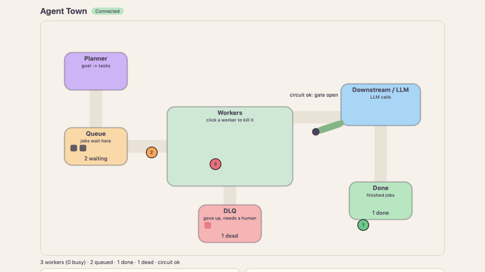
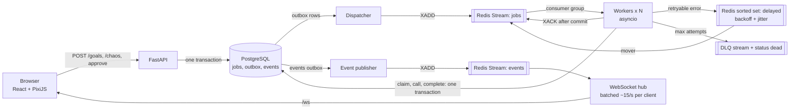

# Agent Town

A live city map of a real distributed job engine. Type a goal, a Gemini planner breaks it into a
task graph, and workers ("agents") process it through Redis Streams with retries, a dead-letter
queue, crash recovery and human approval gates. Every move on the map is a real event from the
backend, and you can kill workers, break the provider and watch the system recover.

**Live demo:** _add the Vercel URL here after deploying (see [docs/DEPLOY.md](docs/DEPLOY.md))._
The site opens on a recorded trace from the real engine, so it works even while the free backend
sleeps, and switches to live when the backend wakes.

<!-- TODO: demo GIF. Record the map (docs/city-map.png is a still):  -->


## Architecture

Planner: prompt, Gemini (JSON schema, validated with Pydantic, retry once, fallback plan) or the
mock planner, then a task DAG. A task is queued only when its dependencies succeeded; a task that
needs approval waits for a click.

## Delivery guarantee
Redis Streams redelivers unacknowledged messages (`XAUTOCLAIM`), so a job can run more than once:
**delivery is at-least-once, not exactly-once.** The external call (the LLM) has no
side effects in our system, so repeating it is safe. Completion is ONE Postgres transaction: update
the job `WHERE status != 'succeeded'`, insert the output (unique on `job_id`), check the affected
row count, commit, and only then `XACK`. A crash between commit and `XACK` causes a redelivery, the
guarded update matches nothing, and nothing is duplicated: at-least-once delivery plus idempotent
completion in one Postgres transaction gives one stored result per job. Likewise a job and its outbox row, and a state change and its event, are
written in one transaction, so the database and the queue cannot disagree.

## Run it
Backend (needs Postgres and Redis; Docker Compose provides both):
```bash
cp .env.example .env
docker compose up -d postgres redis
pip install -e ".[dev]"
EMBEDDED_WORKERS=true uvicorn app.main:app --reload     # API + workers in one process
pytest && ruff check .
```
Frontend:
```bash
cd web && npm ci
npm run dev                  # http://localhost:5173, talks to http://localhost:8000
npm test && npm run e2e      # unit/component tests, Playwright against a mock WebSocket
```
Other tools:
```bash
python scripts/demo_chaos.py --reset --jobs 500      # kill workers mid-job, check every job ends with one stored result
python scripts/record_trace.py --reset               # re-record the four preset traces (wipes the DB!)
bench/run.sh burst 8 2000                            # k6 benchmark (wipes the DB!), see docs/benchmarks.md
python scripts/secret_scan.py                        # the CI secret scan
```
The mock LLM (`app/providers/mock_llm.py`) is used for tests, CI, floods and chaos, so none of the
above spends API quota. Real Gemini is used only for the planner and capped worker calls.

## Benchmarks
Single run per row, on one Apple M3 laptop, local Postgres and Redis, one API process with embedded
workers, mock LLM at about 125 ms per call, k6 on the same machine. Full method and caveats: [docs/benchmarks.md](docs/benchmarks.md).

| What | Result |
|---|---|
| Accepting jobs (`POST /jobs`), steady 600 req/s | p95 1.4 ms, p99 5.5 ms, 0 errors |
| Accepting jobs, burst peak | 2,395 req/s, p95 50.6 ms |
| Processing, 4 / 8 / 16 / 32 workers | 30.6 / 61.5 / 100.0 / 87.3 jobs/s |
| Chaos, 3 runs of 500 jobs, 10% provider errors, 30 to 35 workers killed per run | 1,500/1,500 completed, one stored result and one success event per job, 0 pending (single run of each seed) |

Up to 8 workers it scales to about 96% of ideal; the ceiling of one Python process is about 100
jobs/s. These are single-run local numbers, not numbers for the free-tier deployment.

## Design decisions
Each step's reasoning is in [DECISIONS.md](DECISIONS.md). The ones worth discussing:
- **Transactional outbox** for jobs and for events: a job or event is written in the same transaction as its state change, so the database and Redis cannot disagree; duplicates are removed by id.
- **Retries wait in a Redis sorted set**, not in a worker, so a delay never holds a worker. Exponential backoff with full jitter.
- **Crash recovery** by heartbeat plus `XAUTOCLAIM` after a lease; `heartbeat_ttl < lease` is validated at startup.
- **Protection:** Lua token-bucket rate limits (per IP, per provider), circuit breaker, daily caps, a Redis command-budget guard.
- **The map is driven only by the event store**, never by timers that invent activity; live and recorded traces feed the same store.
- **Recorded traces come from the real engine** and are checked against what each preset claims.
- **Found by testing, not by reading:** a worker-pool crash after every worker was killed, queue counts that drifted, and redis-py 8's 5 s socket timeout colliding with a 5 s blocking read.

## Free-tier limits
The hosted demo (Vercel, Render free, Neon free, Upstash free) is built to stay free and is
therefore limited: the backend sleeps after idle time and takes up to a minute to wake (the site
shows recorded traces meanwhile), live goals and Gemini calls have daily caps, the flood button is
limited to 100 mock jobs, and live mode switches itself off when the Redis command budget is nearly
used. Check each provider's current limits. See [docs/DEPLOY.md](docs/DEPLOY.md).

## Repository map
`app/` backend (engine, API, hub, protection) · `migrations/` SQL · `web/` React + PixiJS app and recorded traces in `web/public/traces/` ·
`tests/` pytest · `scripts/` chaos demo, trace recorder, secret scan · `bench/` k6 benchmark · `docs/` deploy guide, benchmarks, interview notes, progress log · `PLAN.md`, `DECISIONS.md`.
