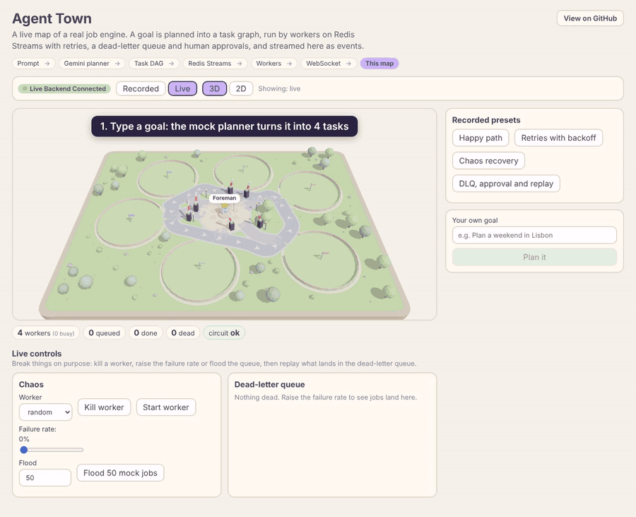
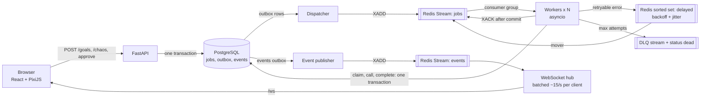

# Agent Town

A distributed job engine you can watch: a goal is planned into a task graph, and worker processes
run it through Redis Streams with retries, a dead-letter queue, crash recovery and approval gates.
Every move on the live city map is a real event from the backend.

**The guarantee:** delivery is at-least-once, and every job ends with exactly one stored result,
even when workers, the dispatcher or Redis are killed mid-job. Not exactly-once: a job can run
twice; completion is idempotent, so it is stored once.

<!-- CHAOS-HEADLINE:START (generated by scripts/chaos_report.py) -->
**Delivery checked under real crashes:** 10,000 jobs, 671 processes killed with SIGKILL (workers, dispatcher, Redis), 0 lost jobs, 0 duplicate outputs. A deliberately broken worker was caught in 10 of 10 runs. [How it is checked](#checked-under-crashes).
<!-- CHAOS-HEADLINE:END -->

<!-- BENCH-HEADLINE:START (generated by scripts/bench_report.py) -->
**Measured:** 240.6 jobs/s with 32 worker processes on 4 cores (mock LLM), p99 250 ms at 60% load; a job whose worker is killed with SIGKILL is taken over in 14.8 s (median, 15 s lease). [Benchmarks](#benchmarks).
<!-- BENCH-HEADLINE:END -->

Every number above is generated from a results file in [`results/`](results/); a test fails if
the README and the data disagree.

## Live demo
[agent-town-delta.vercel.app](https://agent-town-delta.vercel.app) (how it is hosted:
[docs/DEPLOY.md](docs/DEPLOY.md)). The site opens on a recorded trace from the real engine, so it
works while the free backend sleeps, and switches to live when the backend wakes (the first visit
after idle can take up to a minute). In live mode you can kill workers, break the provider and
flood the queue, and watch the engine recover.



_A goal planned by the mock planner, a worker killed mid-job and its job reclaimed by another worker,
then a human approval, on the 3D town and the current page layout. Recorded locally with shortened leases and played at 1.2x;
re-record with [web/scripts/record-demo.mjs](web/scripts/record-demo.mjs)._

## Architecture

Planner: prompt, Gemini (JSON schema, validated with Pydantic, retry once, fallback plan) or the
mock planner, then a task DAG. A task is queued only when its dependencies succeeded; a task that
needs approval waits for a click.

## Delivery guarantee
Redis Streams redelivers unacknowledged messages (`XAUTOCLAIM`), so a job can run more than once:
**delivery is at-least-once, not exactly-once.** Completion is ONE Postgres transaction: update
the job `WHERE status != 'succeeded'`, insert the output (unique on `job_id`), check the affected
row count, commit, and only then `XACK`. A crash before the commit leaves the message pending, so
another worker reclaims it after the lease. A crash between commit and `XACK` causes a redelivery,
the guarded update matches nothing, and nothing is duplicated. Likewise a job and its outbox row,
and a state change and its event, are written in one transaction, so the database and the queue
cannot disagree.

### Checked under crashes
`scripts/chaos_campaign.py` runs the engine as separate processes and crashes them for real while
jobs run: worker processes and the outbox dispatcher are killed with SIGKILL (mostly workers that
are mid-job), and Redis itself is killed and restarted. After each run, an independent checker
([`app/checker.py`](app/checker.py)) reads only Postgres and flags any job that is not finished
(lost), has no or more than one stored output, or has no or more than one success event. To show
the checker is not trivially green, the same campaign also runs a deliberately broken worker that
acknowledges the message *before* committing, and the checker must catch it.

<!-- CHAOS:START (generated by scripts/chaos_report.py) -->
**10,000 jobs, 671 injected crashes, 0 lost jobs, 0 duplicate outputs** (20 runs, campaign `20261125T230551Z`).

|  | Correct worker | Deliberately broken worker (XACK before commit) |
|---|---|---|
| Runs | 20 | 10 |
| Jobs submitted | 10,000 | 5,000 |
| Worker processes killed with SIGKILL | 606 (416 mid-job) | 468 (216 mid-job) |
| Dispatcher killed with SIGKILL | 45 | 17 |
| Redis killed with SIGKILL and restarted | 20 | 12 |
| Jobs that ran more than once | 890 | 243 |
| Lost jobs | **0** | 253 |
| Duplicate outputs / duplicate success events | **0 / 0** | 0 / 0 |
| Runs where the checker found a violation | 0 of 20 | **10 of 10** |

6 worker processes per run, mock LLM, local Postgres and Redis. Raw data: [`results/chaos/campaign.jsonl`](results/chaos/campaign.jsonl).
<!-- CHAOS:END -->

Reproduce: `python scripts/chaos_campaign.py --reset` then `python scripts/chaos_report.py`
(needs Postgres and a `redis-server` binary). CI runs a small version on every pull request
(3 correct runs and 2 broken runs of 150 jobs) and fails if a correct run violates the guarantee
or the checker misses the bug.

## Benchmarks
`scripts/bench_engine.py` runs the engine as separate worker processes (the same ones the chaos
campaign kills) against local Postgres and Redis. For each worker count it measures throughput
(a burst of 100 jobs per worker) and latency at a steady 60% of that throughput, then times
recovery after a worker is killed with SIGKILL.

<!-- BENCH:START (generated by scripts/bench_report.py) -->
| Worker processes | Ideal jobs/s | Measured jobs/s | Of ideal | Latency p50 / p95 / p99 at 60% load |
|---|---|---|---|---|
| 1 | 8 | 8.2 | 102% | 157 / 225 / 233 ms |
| 2 | 16 | 14.9 | 93% | 138 / 229 / 248 ms |
| 4 | 32 | 32 | 100% | 150 / 229 / 240 ms |
| 8 | 64 | 62 | 97% | 157 / 224 / 242 ms |
| 16 | 128 | 124.7 | 97% | 153 / 231 / 247 ms |
| 32 | 256 | 240.6 | 94% | 159 / 236 / 250 ms |

**Recovery after kill -9** (production clocks: lease 15 s, heartbeat TTL 6 s, recovery check every 5 s; 8 trials): another worker took the job over after 14.8 s median (19.8 s max), and it finished 16.8 s median (21.8 s max) after the kill. Recovery time is set by the lease, by design: it is the price of not stealing jobs from workers that are only slow.

4 cores (Intel(R) Xeon(R) Processor @ 2.30GHz), Postgres 16.15, Python 3.12.3, local Redis; mock LLM 50 to 200 ms per call, so one worker's ideal is 8 jobs/s. One run per row (run `20261125T231840Z`). Latency is job created to job completed: outbox poll, queue wait, the mock call, the commit. A value above 100% of ideal is noise in the random mock latency. Raw data: [`results/bench/engine.jsonl`](results/bench/engine.jsonl).
<!-- BENCH:END -->

How to read it: throughput stays close to ideal all the way to 32 processes, so the engine's own
cost per job (a claim transaction, a completion transaction, two stream commands) is small next to
a 125 ms call. That is partly because the mock call is a sleep: 32 waiting processes fit on 4
cores, while real calls would hit provider rate limits long before this. Recovery is either about
the lease or the lease plus one recovery interval, depending on where the kill lands in the
interval; the heartbeat is what stops a slow-but-alive worker's job from being taken.

Reproduce: `python scripts/bench_engine.py --reset` then `python scripts/bench_report.py`. The
older single-process k6 numbers for the HTTP API (2,395 req/s peak, p99 5.5 ms at a steady 600
req/s) are in [docs/benchmarks.md](docs/benchmarks.md).

## Limitations
- **Evidence, not proof.** The chaos results come from one machine. Postgres is never crashed or
  partitioned, and Redis restarts keep their data (AOF with `appendfsync always`); losing Redis
  data is handled by the startup reconcile (`app/reconcile.py`) and is not part of the campaign.
- **Mock LLM.** Every number uses the mock provider, whose call has no outside side effect, which
  is why running a job twice is harmless. A real provider would be called twice for a redelivered
  job, and its latency and rate limits, not the engine, would bound throughput.
- **Local, single-run numbers.** Benchmarks are one run per row on one small machine with Postgres,
  Redis and the load all local: no network round trips, and the load generator shares the CPU.
  They are not numbers for the free-tier deployment.
- **Short clocks in the campaign.** The chaos campaign uses a 0.6 s lease so a run takes seconds;
  the recovery benchmark uses the production 15 s lease.
- **Free-tier hosting.** The hosted demo (Vercel, Render free, Neon free, Upstash free) sleeps when
  idle, has daily caps on live goals and Gemini calls, limits the flood button to 100 mock jobs,
  and switches live mode off when the Redis command budget is nearly used. See
  [docs/DEPLOY.md](docs/DEPLOY.md).

## Configuration
The backend reads these environment variables (`.env.example` has them all; hosted-demo values are in [docs/DEPLOY.md](docs/DEPLOY.md)).

| Variable | Default | What it does |
|---|---|---|
| `PLANNER` | `fixed` | `fixed`: a goal is planned from a preset id into a built-in task graph, with no LLM, no key and no quota; free text gets a 400 and the web app hides the box. `gemini`: the real planner (validated, retried once, fallback plan), mock planner without a key |
| `DATABASE_URL`, `REDIS_URL` | local compose | Postgres and Redis |
| `GEMINI_API_KEY`, `GEMINI_DAILY_CAP` | empty, `50` | Only used when `PLANNER=gemini`; server-side only |
| `LIVE_DEMO`, `CORS_ORIGINS`, `LIVE_GOALS_DAILY_CAP` | off | The public-demo profile and its limits |

## Run it
Backend (needs Postgres and Redis; Docker Compose provides both):
```bash
cp .env.example .env
docker compose up -d postgres redis
pip install -e ".[dev]"
EMBEDDED_WORKERS=true uvicorn app.main:app --reload     # API + workers in one process
pytest && ruff check .
```
Frontend:
```bash
cd web && npm ci
npm run dev                  # http://localhost:5173, talks to http://localhost:8000
npm test && npm run e2e      # unit/component tests, Playwright against a mock WebSocket
```
Other tools:
```bash
python scripts/demo_chaos.py --reset --jobs 500      # kill workers mid-job, check every job ends with one stored result
python scripts/record_trace.py --reset               # re-record the four preset traces (wipes the DB!)
python scripts/chaos_campaign.py --reset            # crash campaign + checker (wipes the DB!), then scripts/chaos_report.py
python scripts/bench_engine.py --reset              # engine benchmark (wipes the DB!), then scripts/bench_report.py
bench/run.sh burst 8 2000                            # older k6 API benchmark (wipes the DB!), see docs/benchmarks.md
python scripts/secret_scan.py                        # the CI secret scan
```
The mock LLM (`app/providers/mock_llm.py`) is used for tests, CI, floods and chaos, so none of the
above spends API quota. Real Gemini is used only for the planner and capped worker calls.

## Design decisions
Each step's reasoning is in [DECISIONS.md](DECISIONS.md). The ones worth discussing:
- **Transactional outbox** for jobs and for events: a job or event is written in the same transaction as its state change, so the database and Redis cannot disagree; duplicates are removed by id.
- **Retries wait in a Redis sorted set**, not in a worker, so a delay never holds a worker. Exponential backoff with full jitter.
- **Crash recovery** by heartbeat plus `XAUTOCLAIM` after a lease; `heartbeat_ttl < lease` is validated at startup.
- **Protection:** Lua token-bucket rate limits (per IP, per provider), circuit breaker, daily caps, a Redis command-budget guard.
- **The map is driven only by the event store**, never by timers that invent activity; live and recorded traces feed the same store.
- **Recorded traces come from the real engine** and are checked against what each preset claims.
- **Found by testing, not by reading:** a worker-pool crash after every worker was killed, queue counts that drifted, and redis-py 8's 5 s socket timeout colliding with a 5 s blocking read.

## Repository map
`app/` backend (engine, API, hub, protection) · `migrations/` SQL · `web/` React + PixiJS app and recorded traces in `web/public/traces/` ·
`tests/` pytest · `scripts/` chaos campaign, engine benchmark, report generators, trace recorder, secret scan · `results/` raw campaign and benchmark data · `bench/` k6 benchmark · `docs/` deploy guide, benchmarks, interview notes, progress log · `PLAN.md`, `DECISIONS.md`.

## Credits
The 3D view (Step 11) is built with [three.js](https://threejs.org) (MIT), react-three-fiber and
drei (MIT). Every building, tree, road and robot in it is generated from three.js primitives, so
no third-party 3D model files are shipped yet. If CC0 packs are added later (Kenney City Kit,
Quaternius robots), they will be listed here even though CC0 needs no attribution.
